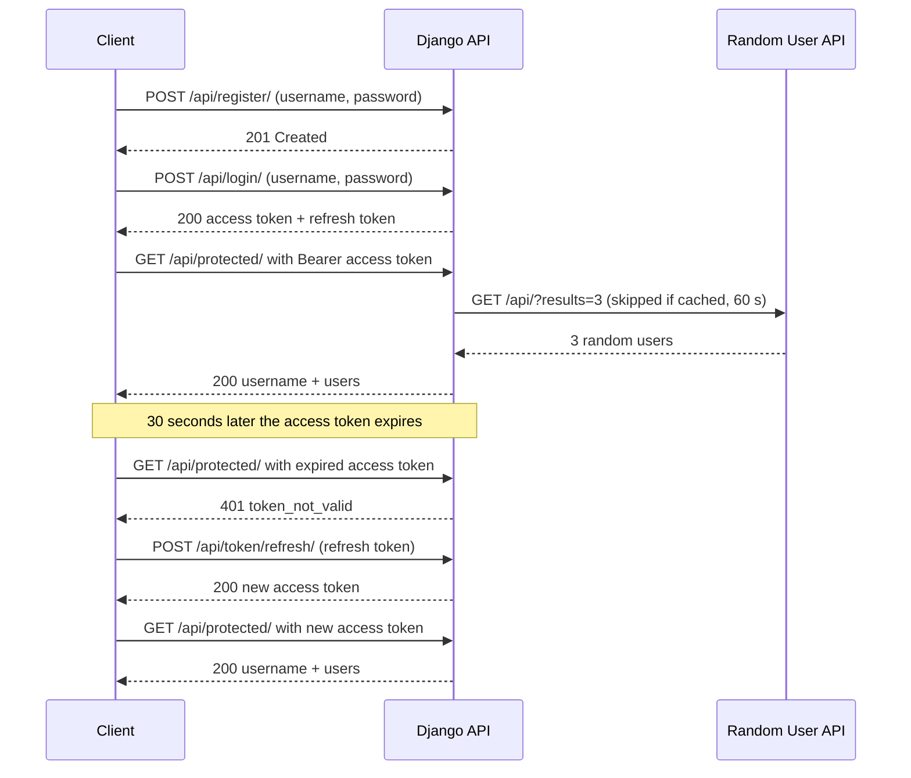

# JWT Authentication in Django REST Framework

## Topic

Course: Introduction to Modern Application Programming (IMAP).

A Django REST Framework API that uses JSON Web Tokens (via `djangorestframework-simplejwt`) for register, login, token refresh, and one protected endpoint. The protected endpoint returns the logged-in username together with data from the [Random User API](https://randomuser.me/).

## Members and Roles

| Name | Role |
|------|------|
| _Member 1_ | _Role_ |
| _Member 2_ | _Role_ |
| _Member 3_ | _Role_ |
| _Member 4_ | _Role_ |

## Architecture Diagram



## Setup Steps

Windows (PowerShell):

```
git clone <repo-url>
cd <repo-folder>
python -m venv venv
venv\Scripts\activate
pip install -r requirements.txt
copy .env.example .env
python -c "from django.core.management.utils import get_random_secret_key as g; print(g())"
```

macOS / Linux: use `source venv/bin/activate` and `cp .env.example .env` instead.

Open `.env` and replace `change-me` with the key printed by the last command. Then:

```
python manage.py migrate
python manage.py runserver
```

Run the tests (the server does not need to be running):

```
pytest -v
```

## How to Run the Demo

1. Terminal 1, start the server: `python manage.py runserver`
2. Terminal 2, activate the venv and run: `python demo/demo.py`

The script prints PASS/FAIL for each step: register, login (with the decoded token header and payload), valid token, tampered signature, tampered payload, expired token (it waits 31 seconds), and refresh.

To show the steps by hand in PowerShell (use `curl.exe`, because `curl` in PowerShell is a different command):

```
curl.exe http://127.0.0.1:8000/api/register/ -d username=alice -d password=Str0ng-Pass-123
$login = curl.exe -s http://127.0.0.1:8000/api/login/ -d username=alice -d password=Str0ng-Pass-123 | ConvertFrom-Json
curl.exe http://127.0.0.1:8000/api/protected/ -H "Authorization: Bearer $($login.access)"
curl.exe http://127.0.0.1:8000/api/token/refresh/ -d refresh=$($login.refresh)
```

## Screenshots

_TODO: take these screenshots and add them here._

1. Server running (`python manage.py runserver`)
2. Register: 201 response
3. Login: response with access and refresh tokens
4. Decoded token header and payload (demo step 2)
5. Protected endpoint with a valid token: 200 with username and users
6. Tampered signature: 401
7. Tampered payload: 401
8. Expired token: 401 `token_not_valid` / "Token is expired"
9. Refresh: new access token, then protected endpoint 200 again
10. `pytest -v` with all tests passing
11. `git status` showing `.env` is not tracked

## Research Questions

### 1. Structure of a JWT?

TODO: write in your own words

### 2. Access vs refresh token?

TODO: write in your own words

### 3. JWT vs session auth: where is each stored and what are the risks?

TODO: write in your own words
